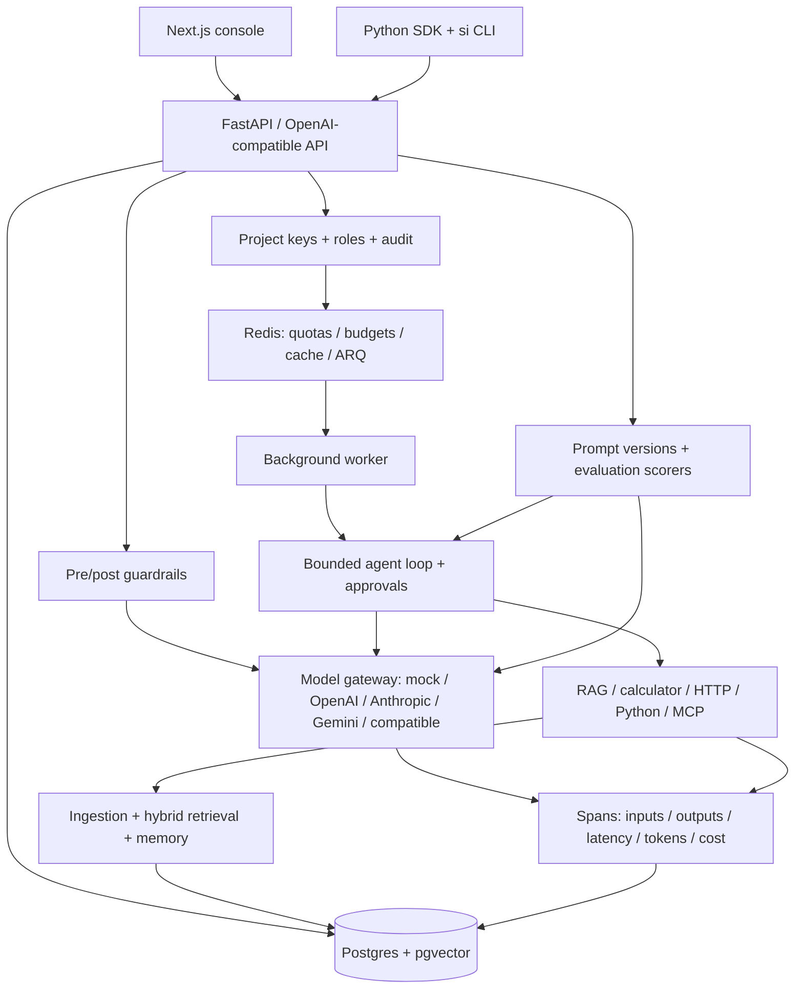
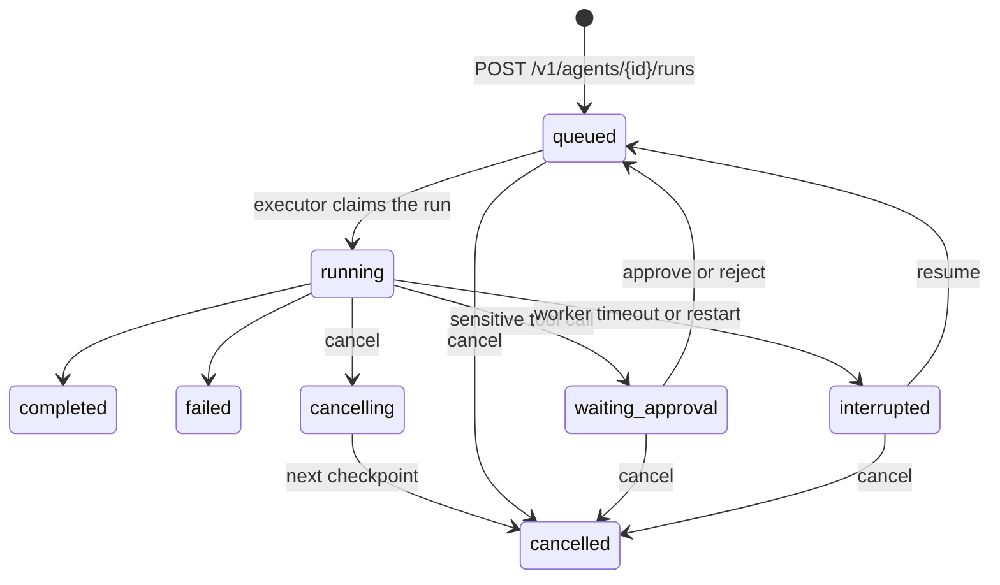

# Architecture

## Contracts and persistence

The gateway normalizes messages, tool calls, JSON-schema responses and usage into
Pydantic models. Adapters use async HTTP calls. Policies choose from configured
models and retry transient errors before fallback; mock is an explicit no-key demo,
not an assertion that a hosted model succeeded. Streaming cannot safely fall back
after content has already been emitted.
The public API deliberately buffers then emits SSE to enforce whole-response
guardrails and exact usage before exposing content; it is not token-time streaming.

The API derives project scope from a hashed API key, not a client-supplied project ID.
Project ownership is checked before accessing collections, agents, runs, prompts,
memory, traces and evaluations. Admins manage keys; developers mutate application
resources; viewers are read-only. Mutations record audit entries.

Alembic creates the schema and pgvector extension. Chunks store 64-dimensional
vectors; Postgres combines cosine similarity and native full-text ranking through
reciprocal-rank fusion. SQLite is a fast unit-test/local-development fallback, not
the deployment retrieval engine. Collection and memory boundaries remain explicit.

Redis holds project limits, monthly reservations/accounting, deterministic response
cache entries, and ARQ jobs. Budget reservation occurs before model work; actual
usage is reconciled afterward. The API fails closed when governance storage is
unavailable. Cached responses remain project-scoped.

The worker persists run transitions and observations. Sensitive tool calls pause
until an authenticated approver resumes them. Interrupted side-effecting work must
not be blindly replayed: inspect events before recovery. SSE reads persisted run
events, so reconnecting clients can observe state.

## Run lifecycle

- **Cancel** (`POST /v1/runs/{id}/cancel`) stops queued, waiting and interrupted
  runs at once. A running run becomes `cancelling`; its executor checks the status
  before each model and tool call and records `cancelled`. Calls already in flight
  finish first, and their side effects are not undone. Repeating a cancel is
  harmless; cancelling a `completed` or `failed` run returns 409.
- **Interrupted** runs are never replayed automatically, because a tool may already
  have run. A cancelled or timed-out worker job marks its run `interrupted`; a
  starting worker does the same to `running` runs, finishes `cancelling` runs as
  `cancelled`, and requeues `queued` ones. A starting worker can't tell orphaned
  runs from live ones, so it also interrupts runs the API is executing inline
  (`background: false` runs and resumes, approvals, agent evals) and, with several
  workers, runs another worker is executing. Run a single worker.
- **Ownership.** Each claim stamps the run with a new token. An executor writes the
  run only while it holds the latest token and the run is `running`, or `cancelling`
  when recording the result of a call already in flight. It checks as it commits,
  holding the row lock on PostgreSQL. An executor whose run was interrupted, resumed
  or claimed again therefore stops at its next write without changing the run. A call
  it had already started still completes and appears in traces.
- **Resume** (`POST /v1/runs/{id}/resume`) requeues only `interrupted` runs, from
  their persisted messages. A pending sensitive tool call needs fresh approval, since
  it may have executed before the interruption; a pending non-sensitive call runs again.
- **Approve or reject** (`POST /v1/runs/{id}/approve`) applies only to
  `waiting_approval` runs, once per pending call; otherwise it returns 409.
- **Deleting** an agent also deletes its runs and their trace spans, and is refused
  with 409 while it has queued, running, waiting or cancelling runs. Deleting a
  collection deletes its chunks, and is refused with 409 while an agent uses it.

`GET /v1/runs` lists runs newest first without transcripts or events; filter by
`agent_id`, `status` or `session_id`. `GET /v1/tools` describes the built-in tools,
whether each is available on this server and why not, and the configured MCP server
prefixes. Agent definitions that name unknown tools are rejected with 422.
`GET /v1/traces` accepts `run_id` and `kind` filters (`model`, `tool`, `gateway`,
`embedding`, `request`). Every authenticated API call records a `request` span.

Prompts are append-only versions with plain variable substitution. Evals store
per-case actual output and scores, plus the configuration they ran with (target,
scorer, threshold, model and case count) and their creation time; list them with
`GET /v1/evals`. Each case passes when its score reaches the threshold; CI gating
on the overall score lives in the CLI, which sends its `--threshold` so both agree.
LLM-judge scores are model-dependent, so deterministic scorers are preferred for
regression gates. Traces are database records; an external OpenTelemetry collector
is optional future deployment integration, not required to run the MVP.

## Deliberate limits

- No fine-tuning, hosted GPU provisioning, visual workflow builder, or enterprise SSO.
- Mock vectors are repeatable but not meaningful semantic embeddings.
- Prices/token estimates require operator verification against provider billing.
- No distributed workflow exactly-once guarantee; persisted observations and
  interruption states prevent blind replay, not all crash windows.
- The subprocess Python tool is opt-in and **not a secure sandbox**.
- HTTP/MCP hosts are explicitly allowlisted; local/private targets are rejected.
- Regex PII and injection heuristics are incomplete. Do not ingest secrets.
- Bootstrap provisions a local project; enterprise tenant provisioning is a future
  control-plane extension. Add operational backups, TLS, retention, secrets rotation,
  database indexes/partitioning, and container hardening before scaling.

Provider, tool, guardrail, connector, reranker, scorer and trace modules are separate
so these limits can be addressed without replacing the API/SDK contracts.
