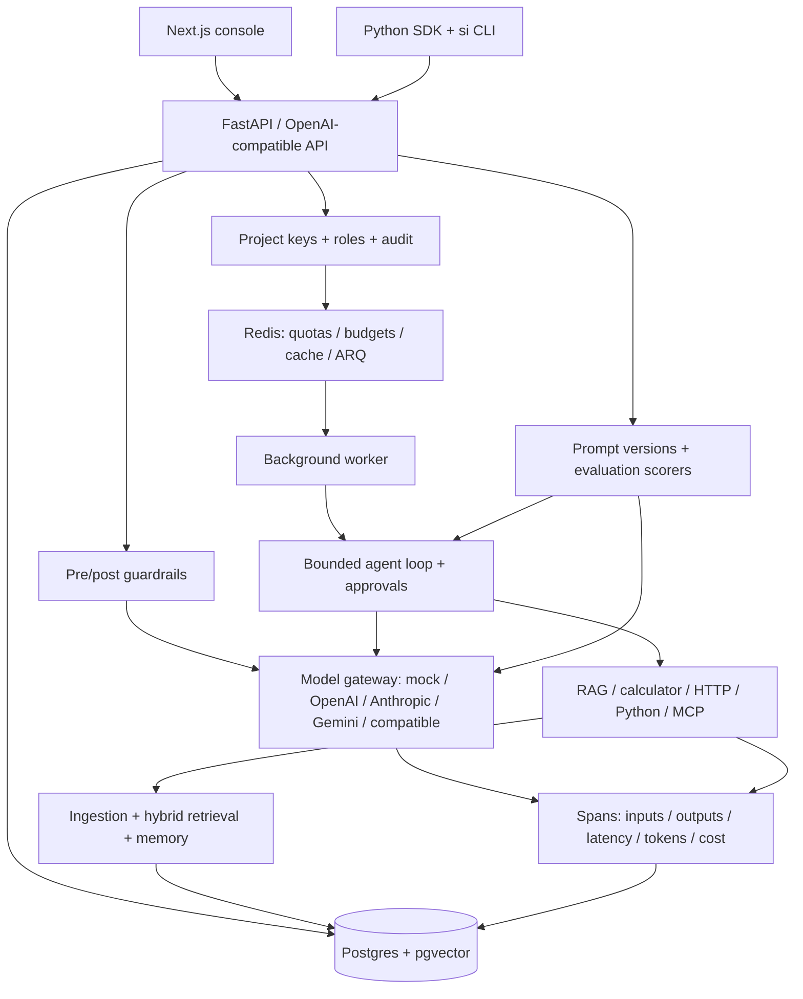

# Architecture

## Contracts and persistence

The gateway normalizes messages, tool calls, JSON-schema responses and usage into
Pydantic models. Adapters use async HTTP calls. Policies choose from configured
models and retry transient errors before fallback; mock is an explicit no-key demo,
not an assertion that a hosted model succeeded. Streaming cannot safely fall back
after content has already been emitted.
The public API deliberately buffers then emits SSE to enforce whole-response
guardrails and exact usage before exposing content; it is not token-time streaming.

The API derives project scope from a hashed API key, not a client-supplied project ID.
Project ownership is checked before accessing collections, agents, runs, prompts,
memory, traces and evaluations. Admins manage keys; developers mutate application
resources; viewers are read-only. Mutations record audit entries.

Alembic creates the schema and pgvector extension. Chunks store 64-dimensional
vectors; Postgres combines cosine similarity and native full-text ranking through
reciprocal-rank fusion. SQLite is a fast unit-test/local-development fallback, not
the deployment retrieval engine. Collection and memory boundaries remain explicit.

Redis holds project limits, monthly reservations/accounting, deterministic response
cache entries, and ARQ jobs. Budget reservation occurs before model work; actual
usage is reconciled afterward. The API fails closed when governance storage is
unavailable. Cached responses remain project-scoped.

The worker persists run transitions and observations. Sensitive tool calls pause
until an authenticated approver resumes them. Interrupted side-effecting work must
not be blindly replayed: inspect events before recovery. SSE reads persisted run
events, so reconnecting clients can observe state.

Prompts are append-only versions with plain variable substitution. Evals store
per-case actual output and scores; threshold decisions live in the CLI for CI use.
LLM-judge scores are model-dependent, so deterministic scorers are preferred for
regression gates. Traces are database records; an external OpenTelemetry collector
is optional future deployment integration, not required to run the MVP.

## Deliberate limits

- No fine-tuning, hosted GPU provisioning, visual workflow builder, or enterprise SSO.
- Mock vectors are repeatable but not meaningful semantic embeddings.
- Prices/token estimates require operator verification against provider billing.
- No distributed workflow exactly-once guarantee; persisted observations and
  interruption states prevent blind replay, not all crash windows.
- The subprocess Python tool is opt-in and **not a secure sandbox**.
- HTTP/MCP hosts are explicitly allowlisted; local/private targets are rejected.
- Regex PII and injection heuristics are incomplete. Do not ingest secrets.
- Bootstrap provisions a local project; enterprise tenant provisioning is a future
  control-plane extension. Add operational backups, TLS, retention, secrets rotation,
  database indexes/partitioning, and container hardening before scaling.

Provider, tool, guardrail, connector, reranker, scorer and trace modules are separate
so these limits can be addressed without replacing the API/SDK contracts.
